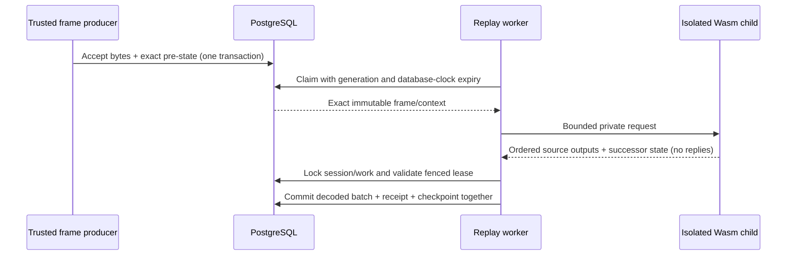

# ADR 0115: Persist fenced stateful protocol replay

## Status

Proposed, 25 October 2026.

Supersedes: none. Superseded by: none.

## Context

Raw acceptance and decoded-result persistence exist, but an in-memory session
cannot recover its pre-frame state after process loss. Before introducing TCP
listeners, recovery needs an exact immutable input and an atomic output/checkpoint
boundary. Historical recovery must never acquire a replacement socket.

## Decision

The ingestion capability owns replay work, fenced leases, executor and repository
ports. PostgreSQL stores a tenant-scoped session, exact accepted frame and copied
pre-state. One pending turn per session applies backpressure; only a committed
predecessor can supply the next sequence and state. Device, package, artifact,
admitted world, policy and execution fingerprint remain immutable.

A worker claims one turn using the database clock, a 30-second lease and increasing
generation, with three attempts. Concurrent workers skip locked work. Expired final
attempts and explicit protocol rejections become terminal poison without advancing
the checkpoint. Storage/executor outages preserve recoverable pending evidence.

Completion locks the session and work, validates the generation and lease, then
appends the complete ordered decoded batch, completion receipt and successor
checkpoint in one transaction. Zero-output turns retain a decoded marker. An exact
completion retry compares the whole batch and retained next-state receipt even
after later turns advance. Lease ownership linearizes at the locked validation;
a later expiry cannot grant a rival writer until that transaction releases its lock.

The composition root offers an explicit Linux-only `replay-worker` command. It
checks the migrated schema and installed sibling executor before claiming. A
single supervised child runs with a cleared environment, private bounded IPC,
fixed Wasm limits, process resource ceilings and a 15-second parent deadline.
Cancellation kills/reaps the child before releasing its execution slot; shutdown
drains cleanup. Server code never links Wasmtime.

The executor response contains only source outputs and state, with closed DTOs
and validating domain reconstruction. Ready/deferred replies are discarded.
Neither queue nor recovery worker has a reply delivery port.

The execution fingerprint hashes a policy tag and exact Cargo.lock bytes. Claims
and expiry cleanup filter that identity. This conservative policy leaves old work
for its original immutable runtime rather than silently changing engines. Changes
to host interpretation or limits require a new policy tag and compatibility review.

## Consequences

Replay is durable and restartable without introducing a broker or listener.
Migration 0033 is additive and empty; existing immutable facts are unchanged.
Session rows, input, poison and completion receipts are retained, including
sensitive raw/state bytes. Retention, diagnostic APIs, automatic poison retry and
cross-version state migration remain separate reviewed work.

Even an unrelated Cargo.lock change changes execution identity. Operators must
drain with the previous image or retain that exact runtime for pending sessions;
there is no automatic compatibility override. Old workers still require their
exact embedded schema; sessions must drain before a schema-changing upgrade. A process resource ceiling is not
a security sandbox or reserved capacity. Deployment still owns process identity,
filesystem, network isolation and database privileges.

See [the replay worker runbook](../operations/protocol-replay.md) for operating
limits, lifecycle and failure semantics. TCP activation, device retransmission
policy, deployment D06 and full-profile qualification remain outside this slice.

## Alternatives considered

- Reconstruct pre-state from the latest session head: loses historical turn identity.
- Commit output and state separately: permits partial effects and skipped frames.
- Run Wasmtime in the server: weakens the established isolated-execution boundary.
- Persist transport replies for automatic replay: risks delivering historical ACKs
  to a different connection and confuses internal retries with device retransmission.
- Automatically execute old inputs under the latest engine: rejected without a
  reviewed compatibility contract.
