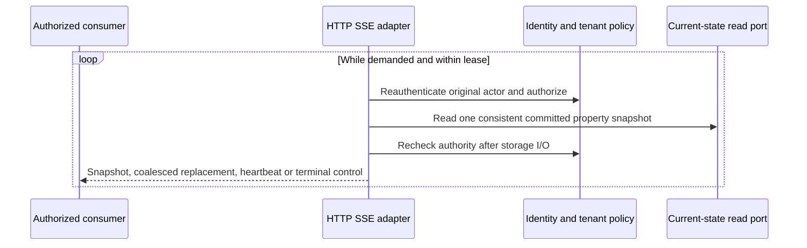

# ADR 0122: Deliver authorized property state over SSE

**TL;DR:** Use bounded, demand-driven SSE to synchronize one exact property's
complete durable current state. Coalesce replacements; do not promise history
replay. Recheck authority and explicitly terminate for recovery.

## Status

Proposed, 28 October 2026.

Supersedes: none. Superseded by: none.

## Context

The inspector can read precise current/history/provenance evidence but cannot
follow committed state without repeatedly replacing its own subscriptions.
Browser identity uses same-origin server sessions. The initial live contract
must survive process restarts without trusting an in-memory delivery buffer,
keep telemetry.read distinct from metadata.read, and bound slow-client work.

ADR 0121 already supplies repeatable exact-property snapshots at atomic tenant
revision/generation positions. A full state replacement does not need each
intermediate interpretation; immutable history remains the evidence source.

## Decision

Publish one GET ending in `/properties/{property_id}/versions/{version}/live`.
Use Axum SSE and futures-util's pull-driven unfold, with no detached producer,
broadcast queue, broker or extra SQL outbox. Add only the already-locked
futures-util package as an explicit server-owned dependency. The projection
application owns pure resume classification; HTTP encoding/lifecycle and
request authentication stay in server adapters. `fleetiq-live` stays a contract
crate; storage/query/transaction ownership does not change.

### Protocol v1

- `snapshot`: complete CurrentPropertySnapshot and an opaque SSE id.
- `replace`: base_revision plus complete replacement snapshot and a new id.
- `heartbeat`: unchanged generation/revision, pending and evaluation instant;
  no id or advancement. It is not device connectivity or asset health.
- `resnapshot-required`: terminal fixed reason, no id. Discard state/cursor and
  open a fresh stream without Last-Event-ID.
- `stream-ended`: terminal fixed reason, no id. Authentication/access/scope
  failures invalidate displayed state; lease expiry permits scoped resume.

SSE ids bind the canonical tenant/asset/property/version tuple using SHA-256,
a codec version, and decimal generation/revision. They are not signatures or
authority. Clients treat them as opaque and retain them only after applying a
complete event. Duplicate/malformed/cross-scope headers fail with HTTP 400 after
authentication/tenant authorization. The window is 256 forward tenant revisions;
rebuilds, future positions and expired windows require a new baseline. Equal
positions return a sampled heartbeat. Normal process restarts lose no cursor
state because the position is durable, not a process sequence.

Coalescing means missed intermediate values cannot be recovered from this
stream. Use bounded history for event-by-event evidence. A reconnect inside the
window receives the latest complete replacement, not a replay log. The window
is a synchronization policy, not a claim that intermediate frames were retained.

### Authority and budgets

Recheck credentials, original actor mapping and current telemetry.read before
and after each storage read, including the first body demand. Browser expiry,
revocation, suspended actors/tenants and lost grants stop further data. Never
cache a grant for the connection. Authorization and emission cannot retract
already serialized bytes from proxy/kernel buffers.

Each process admits at most 64 open streams without a waiter queue. A demanded
stream reads no faster than every two seconds, emits idle heartbeats around
every 16 seconds and ends after a 60-second lease. A demand gap over 30 seconds
requires resnapshot before reading more. Each combined authority/read cycle has
an eight-second deadline; SQL snapshot deadlines remain unchanged. A bounded
writer stops JSON at 60 KiB before constructing an oversized serialization;
SSE framing stays below 64 KiB. No task performs reads while backpressured.
Dropping the body drops pending reads and releases its permit. Terminal controls
release the permit before emission.

Lease/stall checks occur when the body is polled; an unpolled network body cannot
force its own socket closed. Per-process admission still bounds these streams.
Proxy write/idle deadlines and aggregate multi-process admission remain deployment
responsibilities. This slice is functional qualification, not a capacity benchmark.

## Consequences

No new schema, SQLx cache or projector transaction is required. Exact values,
quality, attribution, pending work and evaluation-time freshness reuse the same
snapshot DTO and immutable interpretation encoding as REST.

Polling under active demand costs database authority and snapshot queries per
connection; that is an explicit initial low-scale trade-off. Multi-property or
high-rate fleets may justify a durable change feed/broker later, preserving the
same recovery semantics. Read failures close rather than produce empty state.
Clients must close native EventSource on terminal events and implement bounded
reconnect/backoff; otherwise automatic retry could repeat a rejected cursor.

The contract assumes intact projection revision lineage. Disaster restore and
cursor invalidation across restored/reused counters are not qualified here;
restore procedures must prevent old cursors from being reused before clients
are admitted. PR 27 owns the connected inspector consumer. D06 and full-profile
qualification remain deferred.

## Alternatives considered

WebSockets add bidirectional framing/heartbeat and session machinery without a
current browser command-stream requirement. A broadcast channel loses continuity
on restart and needs a lag policy anyway. A durable per-event outbox is appropriate
for lossless delivery, but duplicates history work when the current requirement
is complete current-state synchronization. Plain repeated REST lacks an explicit
connection/recovery protocol. None is necessary for this initial exact-property
replacement transport.
