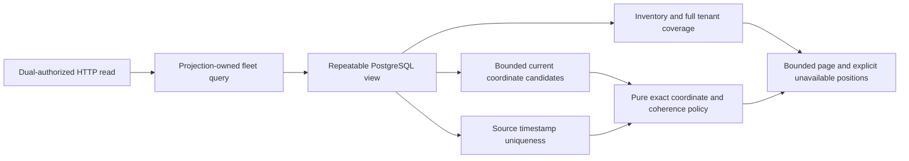

# ADR 0123: Expose observed fleet locations and coverage

**TL;DR:** Read existing inventory and projection evidence in one repeatable
view. Explicit exact-version coordinate mapping, strict source grouping and
independent metadata/telemetry grants replace guessed locations or health.

## Status

Proposed, 28 October 2026.

Supersedes: none. Superseded by: none.

## Context

The inspector has current/history/live evidence. The map and overview still lack
bounded observed coordinates and server-owned inventory/coverage totals. Adding
values from independently queried latest latitude and longitude would fabricate
positions across source packets or device records. Client page accumulation
cannot establish whole-tenant totals.

## Decision

Add one GET `/api/v1/tenants/{tenant_id}/fleet`. Each request explicitly declares
two distinct property identities, exact versions and one encoding. This read
configuration assigns WGS84 latitude/longitude roles; it is not persisted mapping
administration. Degrees require numeric definitions and source unit `deg`.
Integer E7 requires unitless integer definitions/source values, matching the
initial Teltonika vocabulary without introducing a vendor dependency. No datum,
unit conversion, role or property-name inference is performed.

Require separate metadata.read and telemetry.read proofs for the same actor and
tenant. Authentication evidence stays consumable: HTTP reauthenticates for the
second proof, and the application rejects changed actor/tenant identity before
storage. Reads are no-store and failures never become fabricated empty success.

The projection application owns the fleet query, read port and pure position
classification. PostgreSQL owns one repeatable-read, read-only view of exact
definitions, projection head/pending, full tenant counts and bounded asset rows.
Two set-based reads hydrate at most 200 immutable coordinate candidates and detect
ambiguous source groups. Query count is independent of returned asset count.
No schema, worker, external library or materialized fleet cache is added. The
application gains one inward telemetry-contract dependency for source quality.

A point requires distinct source outputs/signals from the same message, decoder
release, device and endpoint, with matching device-recorded event time. Receipt
basis alone cannot group records. Repeated source signal/device timestamp within
that packet is ambiguous and rejected. These are structural provenance guarantees,
not inferred physical accuracy or an undocumented protocol record identifier.
The configured mapping remains responsible for assigning meaningful axis roles.

Missing/unmapped/incompatible/incoherent/out-of-range/invalid-quality states
remain distinct and retain asset selection. Newest invalid values never select
older good positions. Uncertain quality remains uncertain. Freshness is evaluated
independently at one response timestamp. Coordinates, counts and times are exact
strings; decimal range checks never round via floating point. Exact coordinate
text is limited to 128 characters per axis.

Pages contain at most 100 assets with an exclusive C-collated asset key. Totals
cover the entire tenant independent of that cursor: assets, communication-device
capabilities, assets declaring the selected mapping, and assets with any current
property. They are not located/online/healthy totals. Statements have 2s deadlines;
the HTTP read has an 8s total storage deadline. Pages across requests do not share
a database snapshot. Bounded output/deadlines are not large-fleet capacity proof.

## Consequences

The initial query mapping applies one exact property pair to a tenant page.
Assets without that installed pair remain visible and unlocated. Multiple type
profiles, persisted configuration discovery and richer source record identifiers
can evolve independently. Ambiguous equal-time records are conservatively omitted.
Full tenant aggregate work scales with tenant inventory and is protected by the
statement deadline; no cheap constant-time count claim is made.

No SQL migration or new permission is granted. Existing read roles need SELECT
on inventory, immutable definitions/source/history and projection tables. D06,
full-profile installation, the MapLibre renderer and health/alert semantics remain
separate slices. Contract/database fixtures do not qualify hardware or deployment.

## Alternatives considered

A new fleet cache duplicates existing authoritative current state without an
initial freshness or scale requirement. Per-asset REST fan-out costs round trips
and permits mixed revisions. Inferring coordinates from property names or raw
protocol signals crosses semantic ownership. Pairing solely by receipt time can
combine multiple fixes in one packet. Client-counted pages and inferred online or
healthy states overstate available evidence.
