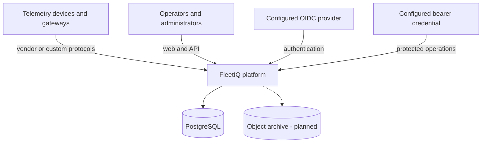
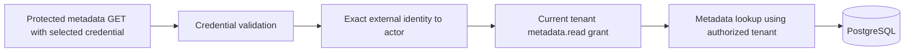
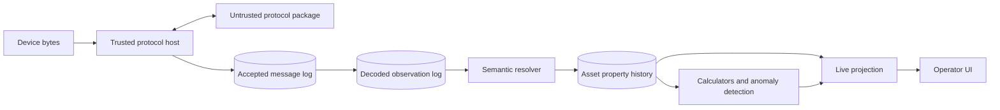
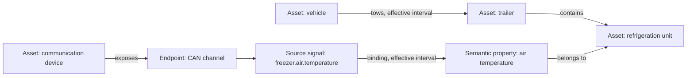
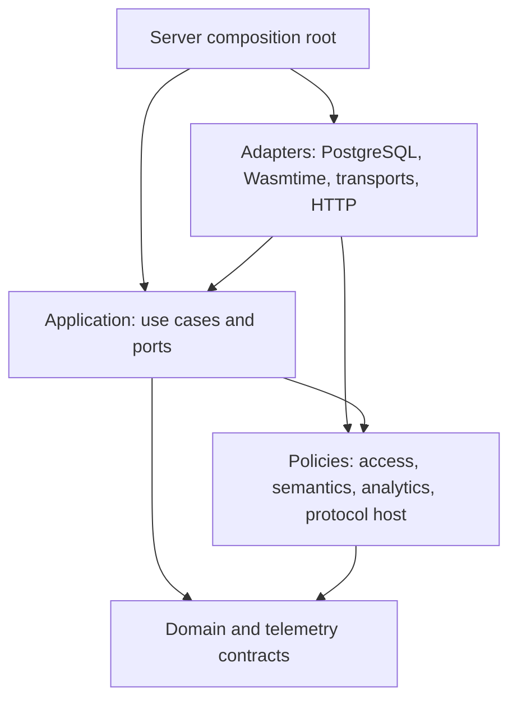

# Architecture

## TL;DR

FleetIQ is a modular Rust system centered on a tenant-owned semantic asset
graph. A trusted ingestion host runs untrusted protocol packages under explicit
resource limits, persists immutable source facts before exposing derived data,
and keeps protocol decoding separate from semantic attribution. PostgreSQL is
the initial transactional source of truth; interfaces allow measured evolution
without committing to premature services or specialized databases.

## System context



The current repository composes its backend foundation into one executable
process. The access policy boundary separates authenticated actors,
selected tenants, and per-action policy decisions. PostgreSQL persists internal
actors and exact grants and evaluates current policy without a cache. The server
provides provider-neutral OIDC login and same-origin operator sessions. Each session retains its original actor and trust-domain binding;
current identity and tenant grants are checked on every read. See the
[browser identity procedure](../operations/browser-identity.md). Protected exact
asset, bounded tenant asset catalogue, device, asset-type, property-definition,
relationship-type, exact relationship-revision,
exact signal-binding-revision, bounded asset-relationship snapshot, bounded
source-binding snapshot, and bounded target-asset binding snapshot queries join
these boundaries through the server composition root; see
[ADR 0079](../adr/0079-protect-initial-asset-query.md),
[ADR 0080](../adr/0080-expose-communication-device-detail.md),
[ADR 0081](../adr/0081-read-exact-asset-type-versions.md),
[ADR 0082](../adr/0082-read-exact-property-definitions.md),
[ADR 0083](../adr/0083-read-exact-relationship-type-versions.md),
[ADR 0084](../adr/0084-read-exact-relationship-revisions.md),
[ADR 0085](../adr/0085-read-exact-signal-binding-revisions.md),
[ADR 0086](../adr/0086-page-bitemporal-asset-relationships.md),
[ADR 0087](../adr/0087-page-bitemporal-source-bindings.md),
[ADR 0088](../adr/0088-page-tenant-asset-catalogue.md), and
[ADR 0089](../adr/0089-page-bitemporal-asset-target-bindings.md). Other business
APIs, device transports, production deployment, archival storage, and the web
application arrive in later milestones.



Actor administration now exposes provisioning, lifecycle commands, the actor
catalogue, and lifecycle audit through the same configured listener. It consumes
exact platform identity.manage evidence in the identity capability, independently
of tenant grants. Browser commands share logout's exact-origin/CSRF guard;
workload authentication remains a separately selected mode. First-receipt command
retries retain the original durable audit time and effect. See
[ADR 0100](../adr/0100-expose-actor-administration-over-http.md).

External-identity commands and bounded mapping/audit reads use the same exact
platform evidence and listener-selected guard in a separate HTTP adapter. Identity
owns first-receipt retry policy and PostgreSQL retains atomic mapping/audit writes;
subjects are returned only to authorized callers and redacted from command diagnostics.
See [ADR 0101](../adr/0101-expose-external-identity-administration-over-http.md).

Platform-access HTTP administration consumes distinct exact platform.access.manage
evidence. It reuses the listener-selected browser guard while composing grant
commands, actor-scoped current grants and immutable audit separately. The shared
transaction lock preserves an active recovery administrator and resolves retries
before mutating current grants. See
[ADR 0102](../adr/0102-expose-platform-access-administration-over-http.md).

Tenant HTTP administration composes provisioning, lifecycle, catalogue and audit
from the identity capability. Provisioning requires tenant.provision; lifecycle
and query operations require tenant.lifecycle.manage. First-receipt retries resolve
before state mutation, and tenant suspension denies fresh tenant access while
retaining platform recovery. See
[ADR 0103](../adr/0103-expose-tenant-administration-over-http.md).

## Browser identity boundary

```mermaid
sequenceDiagram
    participant Browser as Browser (same HTTPS origin)
    participant Server as FleetIQ server
    participant Provider as Configured OIDC issuer
    participant DB as PostgreSQL
    Browser->>Server: GET /api/v1/auth/login
    Server->>DB: Store browser-bound one-use attempt
    Server-->>Browser: 303 + protected login cookie
    Browser->>Provider: Authorization request + PKCE S256
    Provider-->>Browser: Redirect with code and state
    Browser->>Server: Callback + login cookie
    Server->>DB: Atomically consume bound attempt
    Server->>Provider: Exchange code; discover keys and verify identity
    Server->>DB: Resolve active actor and store opaque session digest
    Server-->>Browser: 303 / + protected session cookie
    Browser->>Server: Metadata GET + session cookie
    Server->>DB: Session expiry/trust binding + current actor mapping
    Server->>DB: Current exact tenant metadata.read grant
    Server-->>Browser: Metadata or bounded 401/403 problem
```

The server holds all provider credentials. The browser has no OAuth token or
workload secret. Login and sessions bind the configured issuer/client/authority;
secret rotation alone does not invalidate sessions. See
[ADR 0095](../adr/0095-authenticate-browser-operators-with-oidc-sessions.md).

## Operator access discovery

The access capability also owns authenticated, actor-scoped tenant discovery.
Its PostgreSQL adapter loads bounded active tenants and exact grants in one
statement; no platform catalogue or cached session grant is reused.
[Discovery results](../operations/operator-tenants.md) are presentation hints,
while every metadata read still consumes fresh typed authorization evidence.

## Capability flow



`fleetiq-ingestion` owns durable acceptance and decoded-result orchestration;
PostgreSQL implements its consumer-owned ports. The trusted protocol host owns
framing and validation policy. `fleetiq-history` owns the semantic change
processing operation and append port; PostgreSQL persists that fact, while
the worker, projection, and operator delivery paths in the diagram remain
planned.

Every transition preserves the identity and provenance needed for replay and
diagnosis. Durable source facts precede effects that claim acceptance. See
[extensible ingestion](ingestion.md) and
[telemetry processing](telemetry-processing.md).

## Semantic asset graph



Relationships and signal bindings are revisioned and effective-dated. This
allows late commissioning data and corrections without rewriting history. The
same model supports a locomotive and its subsystems when their definitions are
known. A protected [bounded relationship snapshot](../operations/asset-relationship-snapshot.md)
now reads the edges involving one asset at explicit physical and recorded
times. The protected [source-binding snapshot](../operations/signal-binding-snapshot.md)
shows attribution from one decoded signal, while the
[asset-binding snapshot](../operations/asset-binding-snapshot.md) shows the
bindings targeting one asset at the same two time dimensions.
See [semantic asset graph](semantic-asset-graph.md).

## Dependency direction



Dependencies point toward stable policy and domain meaning. Infrastructure
implements consumer-owned ports. SQL rows, WIT values, wire payloads, and API
documents do not become domain values until validated.

The repository enforces its direct workspace dependency policy with
`cargo xtask architecture`; see [dependency rules](dependency-rules.md).
Semantic resolution owns its read ports and bitemporal snapshot query;
PostgreSQL implements the ports directly. Metadata application code consumes
semantic policy without a reverse dependency or Cargo cycle. See
[ADR 0069](../adr/0069-own-semantic-read-ports-in-policy.md).
The access policy owns authentication and authorization evidence and its
consumer-facing ports; PostgreSQL implements the resolver and policy adapters
directly. See [ADR 0070](../adr/0070-extract-access-policy-boundary.md).

Identity administration has its own application crate. PostgreSQL implements
its ports directly, and the server composes its bootstrap use case. See
[ADR 0073](../adr/0073-extract-identity-application-capability.md).

Asset graph use cases have a separate metadata application crate.
PostgreSQL implements its ports directly. See
[ADR 0074](../adr/0074-extract-asset-graph-application-capability.md).

Durable ingestion orchestration and its ports live in `fleetiq-ingestion`.
PostgreSQL implements those ports directly. See
[ADR 0075](../adr/0075-extract-ingestion-application-capability.md).

Exact durable-observation semantic processing and property-change append
and read ports live in `fleetiq-history`. PostgreSQL verifies each append
against durable source and binding lineage and reads exact interpretations or
source-scoped keyset pages without re-resolving corrected metadata. See
[ADR 0090](../adr/0090-persist-immutable-semantic-property-changes.md),
[ADR 0091](../adr/0091-compose-semantic-history-processing.md),
[ADR 0092](../adr/0092-process-exact-durable-decoded-observation.md),
[ADR 0093](../adr/0093-read-exact-semantic-interpretation.md), and
[ADR 0094](../adr/0094-page-observation-interpretations.md).

Revisioned projection contracts live in `fleetiq-live` without a transport
or persistence dependency. See
[ADR 0076](../adr/0076-extract-live-projection-contracts.md).

Callers now import each capability directly; the temporary application
compatibility facade has been removed. See
[ADR 0078](../adr/0078-retire-application-compatibility-facade.md).

The PostgreSQL adapter remains one crate and database boundary. Its internal
modules now mirror access, identity, metadata, ingestion, and history
capabilities, with one private codec for exact persisted access-action names. See
[ADR 0077](../adr/0077-organize-postgres-adapters-by-capability.md).

The first deployment topology is one modular backend process. It owns startup,
configuration, migration, HTTP routing, health, and shutdown while composing
the policy and adapter crates. See
[ADR 0041](../adr/0041-establish-single-backend-composition-root.md).

## Data ownership and stores

| Data | Initial owner | Mutability model |
|:--|:--|:--|
| Asset types, properties, relationship types | Metadata catalogue | Immutable versions |
| Assets, external identifiers, device endpoints | Metadata | Validated aggregate state |
| Relationships and signal bindings | Metadata history | Append-only revisions with effective intervals |
| Protocol package releases | Package catalogue | Immutable tenant-scoped releases |
| Internal actors and platform or tenant action grants | Identity and authorization | Stable actors with reversible activation; mutable exact grants |
| Tenant operational state and lifecycle audit | Identity and authorization | Reversible activation; append-only idempotent administration facts |
| Actor provisioning evidence | Identity and authorization | Append-only idempotent administration facts |
| Actor lifecycle change audit | Identity and authorization | Append-only idempotent administration facts |
| External identity mappings and change audit | Identity and authorization | Mutable exact mappings; append-only administration facts |
| Platform access change audit | Identity and authorization | Append-only idempotent administration facts |
| Tenant access change audit | Identity and authorization | Append-only idempotent administration facts |
| Accepted wire messages | Ingestion log | Append-only, idempotent facts |
| Decoded observation batches | Ingestion log | Atomic append-only results |
| Asset property changes | Semantic history | Append-only interpretations linked to decoded facts and exact binding revisions |
| Live asset state | Projection, planned | Revisioned derived view |
| Archived raw and historical data | Object storage, planned | Retention-governed immutable objects |

PostgreSQL initially owns transactional metadata, ingestion, and semantic history facts. Object
storage and specialized query stores are introduced only with retention,
volume, recovery, and cost requirements that justify them.

## Trust boundaries

- Device connections, wire bytes, protocol package artifacts, lifted WIT
  values, API input, and customer configuration are untrusted.
- The protocol host owns identity, transport, resource budgets, validation,
  durable writes, replies, and external side effects.
- Tenant identifiers carried by callers are routing context, not proof of
  authorization.
- Authentication establishes a stable internal actor identity; protected
  tenant operations require a fresh allow decision for the exact actor, tenant,
  and application action. Policy absence or failure denies access.
- Routine errors and logs exclude raw payloads, secrets, and customer asset
  data.
- Device commands require a separate authenticated, authorized, auditable, and
  rate-bounded design before production use.

## Architecture evolution

Use an ADR for durable choices about contracts, persistence meaning, security,
runtime topology, or foundational technology. Keep this document as the
current-system map; do not copy chronological decision history into it.

- [ADR index](../adr/README.md)
- [Dependency rules](dependency-rules.md)
- [Per-action tenant authorization decision](../adr/0042-establish-per-action-tenant-authorization-boundary.md)
- [Persisted tenant action grant decision](../adr/0043-persist-exact-tenant-action-grants.md)
- [Audited tenant grant administration decision](../adr/0044-administer-tenant-grants-with-atomic-audit.md)
- [External identity mapping decision](../adr/0046-map-external-identities-to-internal-actors.md)
- [Authenticated authorization input decision](../adr/0047-require-authenticated-actor-evidence-for-authorization.md)
- [Versioned HTTP API boundary decision](../adr/0048-establish-versioned-http-api-boundary.md)
- [Platform authorization scope decision](../adr/0049-separate-platform-from-tenant-authorization.md)
- [Atomic tenant provisioning decision](../adr/0050-provision-tenants-atomically-with-initial-access.md)
- [One-time platform bootstrap decision](../adr/0051-bootstrap-the-first-platform-operator-once.md)
- [Explicit bootstrap command decision](../adr/0052-invoke-bootstrap-through-an-explicit-process-command.md)
- [Atomic actor provisioning decision](../adr/0053-provision-actors-atomically-with-initial-identity.md)
- [Audited platform grant administration decision](../adr/0054-administer-platform-grants-with-atomic-audit.md)
- [Platform access audit query decision](../adr/0055-query-platform-access-audit-with-keyset-pages.md)
- [Audited external-identity administration decision](../adr/0056-administer-external-identities-with-atomic-audit.md)
- [External-identity audit query decision](../adr/0057-query-external-identity-audit-with-keyset-pages.md)
- [Actor lifecycle administration decision](../adr/0058-administer-actor-lifecycle-with-atomic-audit.md)
- [Actor lifecycle audit query decision](../adr/0059-query-actor-lifecycle-audit-with-keyset-pages.md)
- [Tenant lifecycle administration decision](../adr/0060-administer-tenant-lifecycle-with-atomic-audit.md)
- [Tenant lifecycle audit query decision](../adr/0061-query-tenant-lifecycle-audit-with-keyset-pages.md)
- [Tenant catalogue query decision](../adr/0062-query-tenant-catalogue-with-keyset-pages.md)
- [Actor catalogue query decision](../adr/0063-query-actor-catalogue-with-keyset-pages.md)
- [Current external identities query decision](../adr/0064-query-current-external-identities-by-actor.md)
- [Current platform grants query decision](../adr/0065-query-current-platform-grants-by-actor.md)
- [Capability dependency enforcement decision](../adr/0066-enforce-capability-dependency-policy.md)
- [Current implementation state](../development/current-state.md)
- [Product scope](../product/README.md)
- [Implementation milestones](../roadmap/milestones.md)
