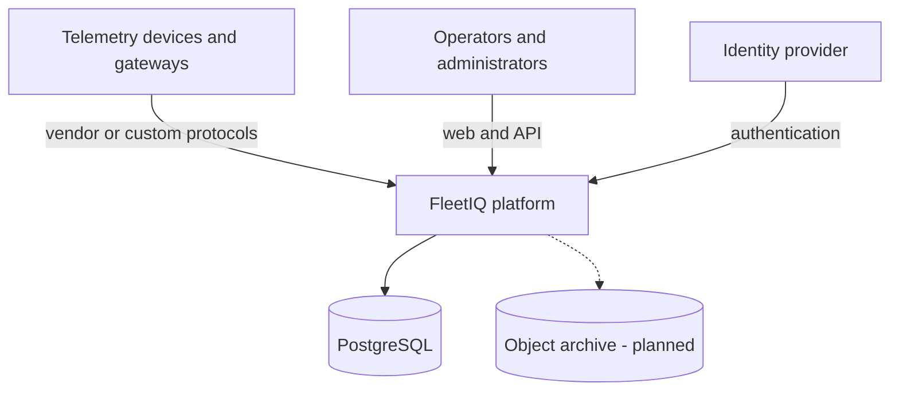
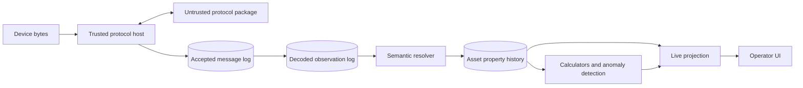
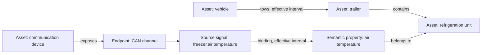
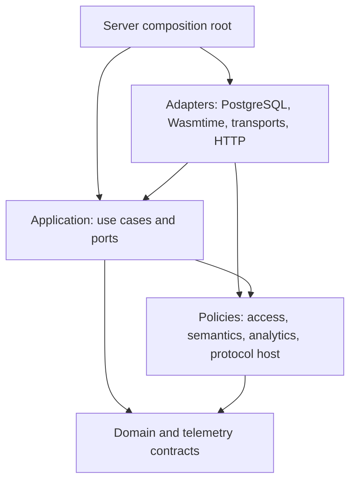

# Architecture

## TL;DR

FleetIQ is a modular Rust system centered on a tenant-owned semantic asset
graph. A trusted ingestion host runs untrusted protocol packages under explicit
resource limits, persists immutable source facts before exposing derived data,
and keeps protocol decoding separate from semantic attribution. PostgreSQL is
the initial transactional source of truth; interfaces allow measured evolution
without committing to premature services or specialized databases.

## System context

The current repository composes its backend foundation into one executable
process. The access policy boundary separates authenticated actors,
selected tenants, and per-action policy decisions. PostgreSQL persists internal
actors and exact grants and evaluates current policy without a cache; identity-
provider integration remains planned. Business APIs, device transports,
production deployment, archival storage, and the web application arrive in
later milestones.

## Capability flow

Every transition preserves the identity and provenance needed for replay and
diagnosis. Durable source facts precede effects that claim acceptance. See
[extensible ingestion](ingestion.md) and
[telemetry processing](telemetry-processing.md).

## Semantic asset graph

Relationships and signal bindings are revisioned and effective-dated. This
allows late commissioning data and corrections without rewriting history. The
same model supports a locomotive and its subsystems when their definitions are
known. See [semantic asset graph](semantic-asset-graph.md).

## Dependency direction

Dependencies point toward stable policy and domain meaning. Infrastructure
implements consumer-owned ports. SQL rows, WIT values, wire payloads, and API
documents do not become domain values until validated.

The repository enforces its direct workspace dependency policy with
`cargo xtask architecture`; see [dependency rules](dependency-rules.md).
Semantic resolution owns its read ports and bitemporal snapshot query;
PostgreSQL implements the ports directly. Metadata application code consumes
semantic policy without a reverse dependency or Cargo cycle. See
[ADR 0069](../adr/0069-own-semantic-read-ports-in-policy.md).
The access policy owns authentication and authorization evidence and its
consumer-facing ports; PostgreSQL implements the resolver and policy adapters
directly. See [ADR 0070](../adr/0070-extract-access-policy-boundary.md).

Identity administration now has its own application crate. PostgreSQL implements
its ports directly, and the server composes its bootstrap use case without
directly importing the remaining broad application facade. See
[ADR 0073](../adr/0073-extract-identity-application-capability.md).

Asset graph use cases now have a separate metadata application crate.
PostgreSQL implements its ports directly while the remaining application crate
re-exports the public API for compatibility. See
[ADR 0074](../adr/0074-extract-asset-graph-application-capability.md).

The first deployment topology is one modular backend process. It owns startup,
configuration, migration, HTTP routing, health, and shutdown while composing
the policy and adapter crates. See
[ADR 0041](../adr/0041-establish-single-backend-composition-root.md).

## Data ownership and stores

| Data | Initial owner | Mutability model |
|:--|:--|:--|
| Asset types, properties, relationship types | Metadata catalogue | Immutable versions |
| Assets, external identifiers, device endpoints | Metadata | Validated aggregate state |
| Relationships and signal bindings | Metadata history | Append-only revisions with effective intervals |
| Protocol package releases | Package catalogue | Immutable tenant-scoped releases |
| Internal actors and platform or tenant action grants | Identity and authorization | Stable actors with reversible activation; mutable exact grants |
| Tenant operational state and lifecycle audit | Identity and authorization | Reversible activation; append-only idempotent administration facts |
| Actor provisioning evidence | Identity and authorization | Append-only idempotent administration facts |
| Actor lifecycle change audit | Identity and authorization | Append-only idempotent administration facts |
| External identity mappings and change audit | Identity and authorization | Mutable exact mappings; append-only administration facts |
| Platform access change audit | Identity and authorization | Append-only idempotent administration facts |
| Tenant access change audit | Identity and authorization | Append-only idempotent administration facts |
| Accepted wire messages | Ingestion log | Append-only, idempotent facts |
| Decoded observation batches | Ingestion log | Atomic append-only results |
| Asset property changes | Telemetry history, planned | Append-only semantic facts |
| Live asset state | Projection, planned | Revisioned derived view |
| Archived raw and historical data | Object storage, planned | Retention-governed immutable objects |

PostgreSQL initially owns transactional metadata and ingestion facts. Object
storage and specialized query stores are introduced only with retention,
volume, recovery, and cost requirements that justify them.

## Trust boundaries

- Device connections, wire bytes, protocol package artifacts, lifted WIT
  values, API input, and customer configuration are untrusted.
- The protocol host owns identity, transport, resource budgets, validation,
  durable writes, replies, and external side effects.
- Tenant identifiers carried by callers are routing context, not proof of
  authorization.
- Authentication establishes a stable internal actor identity; protected
  tenant operations require a fresh allow decision for the exact actor, tenant,
  and application action. Policy absence or failure denies access.
- Routine errors and logs exclude raw payloads, secrets, and customer asset
  data.
- Device commands require a separate authenticated, authorized, auditable, and
  rate-bounded design before production use.

## Architecture evolution

Use an ADR for durable choices about contracts, persistence meaning, security,
runtime topology, or foundational technology. Keep this document as the
current-system map; do not copy chronological decision history into it.

- [ADR index](../adr/README.md)
- [Dependency rules](dependency-rules.md)
- [Per-action tenant authorization decision](../adr/0042-establish-per-action-tenant-authorization-boundary.md)
- [Persisted tenant action grant decision](../adr/0043-persist-exact-tenant-action-grants.md)
- [Audited tenant grant administration decision](../adr/0044-administer-tenant-grants-with-atomic-audit.md)
- [External identity mapping decision](../adr/0046-map-external-identities-to-internal-actors.md)
- [Authenticated authorization input decision](../adr/0047-require-authenticated-actor-evidence-for-authorization.md)
- [Versioned HTTP API boundary decision](../adr/0048-establish-versioned-http-api-boundary.md)
- [Platform authorization scope decision](../adr/0049-separate-platform-from-tenant-authorization.md)
- [Atomic tenant provisioning decision](../adr/0050-provision-tenants-atomically-with-initial-access.md)
- [One-time platform bootstrap decision](../adr/0051-bootstrap-the-first-platform-operator-once.md)
- [Explicit bootstrap command decision](../adr/0052-invoke-bootstrap-through-an-explicit-process-command.md)
- [Atomic actor provisioning decision](../adr/0053-provision-actors-atomically-with-initial-identity.md)
- [Audited platform grant administration decision](../adr/0054-administer-platform-grants-with-atomic-audit.md)
- [Platform access audit query decision](../adr/0055-query-platform-access-audit-with-keyset-pages.md)
- [Audited external-identity administration decision](../adr/0056-administer-external-identities-with-atomic-audit.md)
- [External-identity audit query decision](../adr/0057-query-external-identity-audit-with-keyset-pages.md)
- [Actor lifecycle administration decision](../adr/0058-administer-actor-lifecycle-with-atomic-audit.md)
- [Actor lifecycle audit query decision](../adr/0059-query-actor-lifecycle-audit-with-keyset-pages.md)
- [Tenant lifecycle administration decision](../adr/0060-administer-tenant-lifecycle-with-atomic-audit.md)
- [Tenant lifecycle audit query decision](../adr/0061-query-tenant-lifecycle-audit-with-keyset-pages.md)
- [Tenant catalogue query decision](../adr/0062-query-tenant-catalogue-with-keyset-pages.md)
- [Actor catalogue query decision](../adr/0063-query-actor-catalogue-with-keyset-pages.md)
- [Current external identities query decision](../adr/0064-query-current-external-identities-by-actor.md)
- [Current platform grants query decision](../adr/0065-query-current-platform-grants-by-actor.md)
- [Capability dependency enforcement decision](../adr/0066-enforce-capability-dependency-policy.md)
- [Current implementation state](../development/current-state.md)
- [Product scope](../product/README.md)
- [Implementation milestones](../roadmap/milestones.md)
