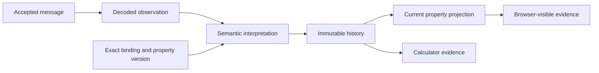

# Domain ownership and evidence

## TL;DR

The [glossary](../../GLOSSARY.md) owns shared product terminology. This map records
current implementation and the domain policies explicitly endorsed in the
22-question owner interview on 21 November 2026. It does not accept or rewrite
historical proposed ADRs. Future correction behavior remains open below.

## Ownership across the application

| Owner | Authority | Boundary |
| --- | --- | --- |
| Platform | Persisted meaning, authorization, semantics and published HTTP contracts | Protocol observations acquire business attribution only through explicit semantic configuration |
| [UI](https://github.com/stanimirivanov/fleetiq-ui/blob/main/docs/agents/domain.md) | Browser behavior and evidence presentation | Consumes an exact platform contract snapshot; presentation does not grant authority |
| [Simulator](https://github.com/stanimirivanov/fleetiq-simulator/blob/main/docs/agents/domain.md) | Synthetic scenarios, protocol emission and transport observations | Device aliases and wire acknowledgements do not establish registered identity or product acceptance |
| [Deploy](https://github.com/stanimirivanov/fleetiq-deploy/blob/main/docs/agents/domain.md) | Composition, release selection and installed integration qualification | Selects artifacts and configuration; does not invent semantic meaning |

Definitions remain tenant-owned; cross-tenant reuse requires deliberate copying
or a future explicit shared-catalogue design. Platform administration does not
imply tenant data authority. Read, manage and acknowledgement grants remain
independent. A fleet view is tenant-scoped inventory, not a separately owned
fleet membership aggregate.

## Module and contract map

| Module boundary | Owns | Evidence |
| --- | --- | --- |
| Domain and metadata | Assets, communication capability, exact definitions and registration | [Asset](../../crates/domain/src/asset.rs), [device](../../crates/domain/src/device.rs), [ADR 0107](../adr/0107-register-assets-and-communication-devices.md) |
| Identity and access | Actors, tenant and platform authority | [ADR 0049](../adr/0049-separate-platform-from-tenant-authorization.md) |
| Ingestion and telemetry | Accepted messages, exact package/world routing and decoded facts | [ADR 0113](../adr/0113-activate-revisioned-device-protocol-routes.md), [ADR 0116](../adr/0116-accept-bounded-durable-tcp-sessions.md) |
| Semantics and history | Binding selection and immutable attributed evidence | [Semantic worker](../operations/semantic-worker.md), [ADR 0118](../adr/0118-run-durable-semantic-processing.md) |
| Projection | Current values, fleet views and live synchronization | [ADR 0121](../adr/0121-materialize-durable-current-property-state.md), [ADR 0123](../adr/0123-expose-observed-fleet-locations-and-coverage.md) |
| Analytics and alerts | Derived evidence, rule selection, lifecycle and notification work | [ADR 0131](../adr/0131-evaluate-durable-alert-lifecycles.md), [ADR 0133](../adr/0133-acknowledge-exact-alert-versions.md) |
| History lifecycle | Archive publication, bounded restore and explicit coverage | [ADR 0146](../adr/0146-query-restored-history-with-explicit-coverage.md), [ADR 0149](../adr/0149-produce-versioned-numeric-downsampling.md) |
| Server and PostgreSQL | Transport/composition and persistence adapters respectively | [Dependency rules](dependency-rules.md), [HTTP contract](../../contracts/http/README.md) |

Modular OpenAPI sources own the published HTTP shape; generated bundles are
artifacts. Consumers pin exact versions and validate their supported subset.
Protocol signal meaning, semantic attribution and presentation roles are distinct:
coordinate roles require explicit mapping rather than property-name inference.
Admission of a protocol release, device registration, route activation and peer
authentication are separate decisions.

## Time, correction and evidence

A property change can repeat a value. The semantic worker prefers device event
time when present, otherwise receipt time, and retains a selected knowledge
cutoff. This does not validate clock accuracy. Effective time and recorded time
answer different questions; shared cutoffs do not imply a cross-request snapshot.

Corrections add interpretations. A corrected binding can attribute evidence to
another asset without retracting the old asset’s history or current-state
consequences. Ordinary polling does not automatically reinterpret previously
unresolved observations when configuration changes. Retry, protocol replay and
reinterpretation therefore require distinct wording and explicit inputs.

Current projection retains the newest invalid or uncertain evidence; it does not
silently fall back to older good values. Freshness, quality, coherent location and
connection liveness remain distinct. SSE synchronizes latest state rather than
promising lossless historical delivery. Protocol acknowledgement, durable
acceptance, semantic processing, projection, browser visibility and receiver
delivery each require evidence at their own boundary.

Publication and activation are separate. Historical command receipts do not prove
current selection. Alert acknowledgement annotates an exact transition without
resolving the condition or suppressing notifications. Restored selections and
numeric summaries carry coverage; neither implies complete raw history.

## Open decisions

- **Automatic retraction or replacement after attribution correction:** define
  effects on old-target history, current projection and downstream derived work
  before selecting a future policy. Current additive behavior remains documented.
- **Automatic reinterpretation after configuration changes:** define eligibility,
  selected knowledge, budgets and audit behavior before implementing scheduling.
  Adding configuration alone currently does not reopen every unresolved result.

These are unresolved product choices, not accepted ADRs or implementation tasks.
Existing [ADR statuses](../adr/README.md) remain unchanged. New records require a
missing durable trade-off and explicit endorsement; implementation alone is not
ratification.
