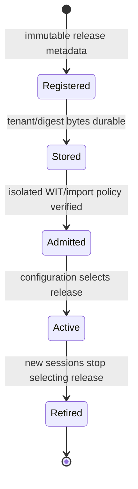
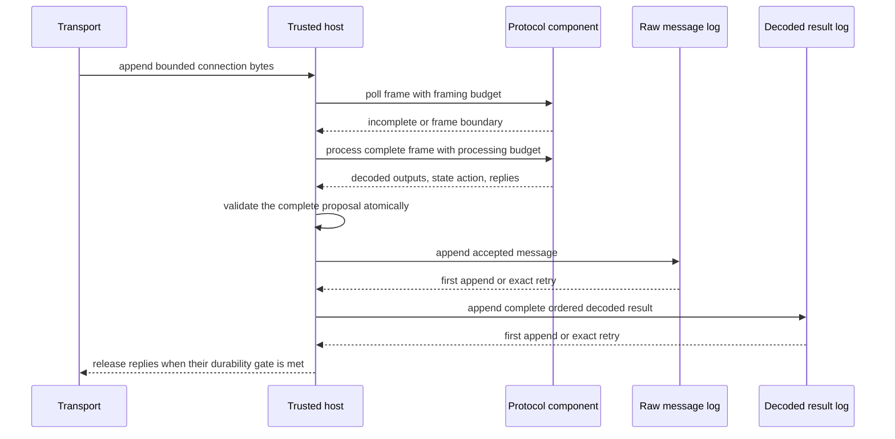

# Extensible device ingestion

## TL;DR

FleetIQ supports vendor and custom protocols through versioned WebAssembly
components. Packages propose framing, decoded values, state changes, and
replies; a trusted host validates and bounds every proposal. Raw acceptance and
decoded results are separate durable, idempotent stages so response loss can be
retried without duplicating facts.

## Responsibilities

The transport host owns connection lifecycle, authenticated device identity,
tenant context, package selection, input buffering, output writes, time,
resource budgets, and persistence. A protocol package owns only its protocol's
framing and decoding rules plus opaque bounded session state.

Packages receive borrowed or copied bounded inputs and return proposals. They
cannot directly access sockets, databases, credentials, filesystems, clocks, or
networks. Any future host capability needs a narrow contract, denial behavior,
resource policy, tests, and an ADR.

## Package lifecycle

The protected registration API stores bounded bytes transactionally in PostgreSQL
after catalogue registration; exact retries repair an interrupted upload. Separate
`protocol.manage` authority governs registration and policy-versioned admission.
A supervised Linux compiler child checks the exact stored bytes; successful
evidence grants no activation authority. See [operator procedure](../operations/protocol-package-admission.md).

Registration records a tenant-scoped package ID, version, host-computed artifact
digest, and byte length. Admission verifies the exact supported WIT world and
host-import policy before a component may process traffic. Activation is an explicit revisioned device/channel configuration, separate
from admission. Registered identity lookup is host-scoped and does not
authenticate a peer. Revalidate pinned handoffs before each future bounded turn;
see [route commissioning](../operations/protocol-route-commissioning.md).
Catalogue presence never grants execution authority.

The first vendor implementation is the bounded [Teltonika TCP package](../../packages/teltonika/README.md).
Its wire parser is independent of WIT, host identity and business semantics;
source time, scaled GPS fields and exact unknown IO survive without asset attribution.

## Session turn

Framing extracts at most one validated prefix from a bounded host input buffer.
Processing uses the extracted frame and the same host-owned session state. Each
operation receives a separate fuel and wall-clock budget and runs in a fresh
bounded store and component instance. Explicit session-state bytes provide
continuity.

The host validates output counts, reply counts, individual and aggregate reply
bytes, state size, identifiers, timestamps, values, and pointer-length ranges
before applying any proposed effect. Failure leaves prior session state intact.

## Durability and retries

An accepted message is an immutable fact containing a stable message identity,
tenant and device identity, pinned package release, receipt time, and exact wire
bytes. The caller assigns its identity before append. First append and an exact
retry are successful outcomes; reuse of the identity with different immutable
content is an error.

One accepted message's decoded result is stored as a marker plus its complete,
ordered observation collection in one transaction. The marker records
successful decoding even when the package emits no observations. Child rows are
batched with set-based SQL. A retry compares the complete immutable batch.

The `fleetiq-ingestion` application capability returns the exact pending value
after an ambiguous storage failure so the caller can retry without reconstruction. Replies gated only on
raw-message durability remain independent of later decoded-result persistence.

## Resource and failure boundaries

Resource limits cover raw artifact size, compilation admission, fuel,
wall-clock interruption, approximate guest stack, linear memory, table
elements, host input, opaque transfer, output collections, replies, and session
state. Each limit describes what it does and does not bound. Compilation and
activation capacity remain distinct from message-processing capacity.

Package rejection, admission failure, runtime interruption, invalid lifted
values, host-policy rejection, transport failure, and persistence failure are
separate outcomes. Package-controlled bytes stay out of routine errors.

## Related decisions

The detailed contracts and consequences are recorded in
[ADRs 0004–0040](../adr/README.md). The
[current state](../development/current-state.md) identifies which lifecycle and
runtime capabilities are implemented today.

## Live TCP ownership

The explicit listener composes connection-local ingestion policy with PostgreSQL
and isolated protocol execution. The application owns validation, route pinning,
reply stages and durable sequencing; server adapters own sockets, private child
IPC, quotas and shutdown. Historical replay has no transport reply port.
See [ADR 0116](../adr/0116-accept-bounded-durable-tcp-sessions.md) and the
[TCP runbook](../operations/tcp-ingestion.md).

## Operational evidence

Authorized [diagnostics](../operations/ingestion-diagnostics.md) expose bounded durable worker-state and observed-source evidence, with unknown process/connection liveness. See [ADR 0117](../adr/0117-publish-bounded-ingestion-evidence.md).
