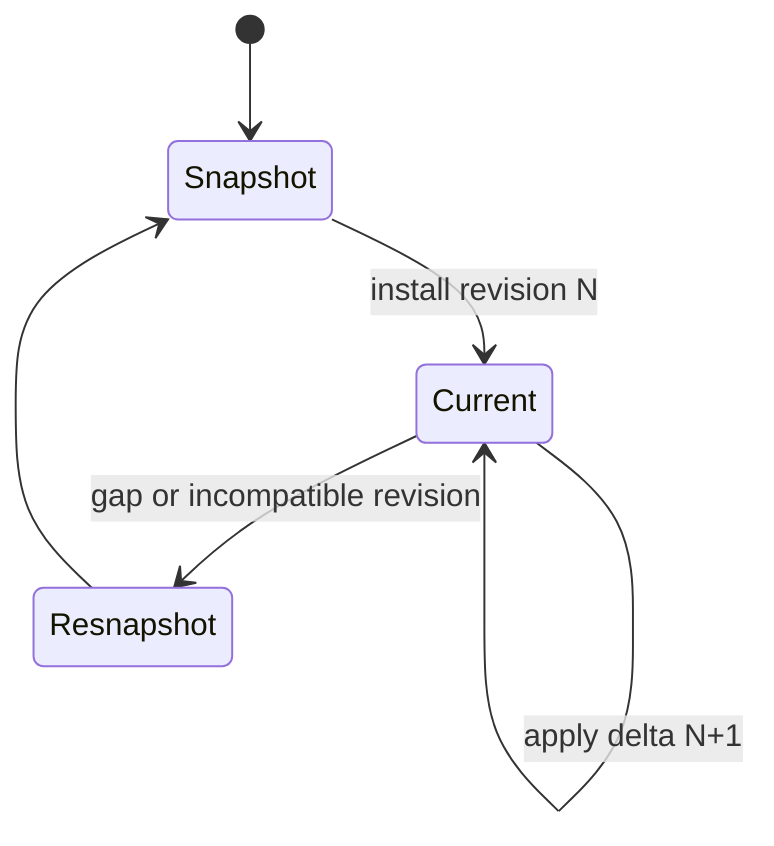
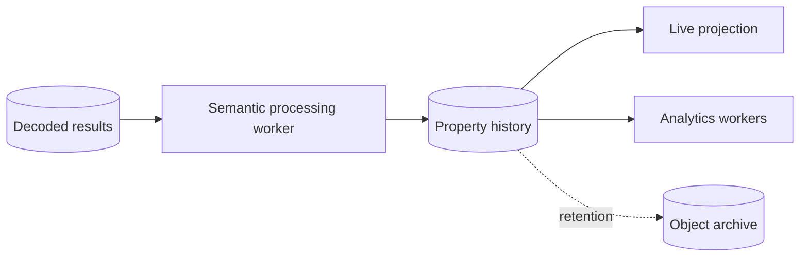

# Telemetry processing and live state

## TL;DR

Decoded observations preserve protocol facts and provenance. Semantic
resolution converts compatible observations into asset property changes.
Versioned calculators derive further properties, and revisioned projections
provide live state with explicit gap recovery. Durable history and production
workers remain planned capabilities.

## Decoded observations

A decoded observation has deterministic replay identity; tenant, device,
endpoint, and source-signal provenance; device and host receipt times; a typed
value; optional unit; quality; and the exact protocol package release. Values
remain protocol-neutral and do not claim an asset property before binding.

One accepted message owns one atomic ordered decoded result, including a valid
zero-output result. This is the handoff from device-specific interpretation to
semantic processing.

## Semantic resolution

The resolver obtains binding candidates and exact property definitions through
semantic-policy-owned read ports implemented by PostgreSQL. It applies
recorded-time and effective-time rules, checks value-kind and unit
compatibility, and returns a bound or unresolved
outcome. It does not query PostgreSQL directly and does not hide missing
configuration as dropped telemetry.

An asset property change records the selected event-time basis and a
deterministic semantic-interpretation identity. Future conversion and
multi-source authority policies require explicit versioned contracts so replay
does not depend on mutable global configuration.

## Analytics

Calculator evaluations have versioned calculator provenance, separate event
and evaluation times, and deterministic output identity. Calculators operate on
semantic properties rather than vendor parameter numbers. Stateful windows,
change-point detection, anomaly models, scheduling, persistence, and failure
isolation are planned around this contract.

## Live projection

The `fleetiq-live` contract crate defines complete snapshots, forward-only
deltas, and revision cursors. A consumer applies a delta only to the expected
prior revision. Gaps, stale consumers, incompatible projection versions, and
retention loss require an explicit resnapshot rather than silent repair.

Projection consumers import these types from `fleetiq-live`. See
[ADR 0076](../adr/0076-extract-live-projection-contracts.md).

Transport choice, subscription authorization, fan-out, backpressure, and
offline recovery remain adapter and product decisions.

## Planned storage path

The append-only property-change history now persists exact semantic
interpretation identities with tenant-safe decoded-observation and binding
references. The processing worker and history read API remain planned. The
initial design favors PostgreSQL for transactional history and a separate
object archive only when volume and retention economics justify it. Query
stores and caches are derived and rebuildable. The source facts and pinned
versions needed for replay remain durable.

See ADRs [0002](../adr/0002-decoded-observation-contract.md),
[0003](../adr/0003-explicit-semantic-resolution.md),
[0006](../adr/0006-asset-property-change-contract.md),
[0007](../adr/0007-calculator-output-contract.md), and
[0008](../adr/0008-revisioned-live-projection-contract.md).
