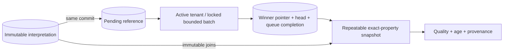

# Current property state and projector

## TL;DR

- Apply migration 0037 and reviewed role grants before resuming history writers.
- `fleetiq-server project-current` runs one bounded, checked-schema projector.
- The exact-property current endpoint requires fresh `telemetry.read`.
- Current rows, queue completion and revision commit together; sequence IDs are
  never a watermark. Errors retain pending work.
- Rebuild one active tenant with explicit private runtime configuration; it
  atomically advances generation/revision and preserves later pending commits.
- D06 and full-profile installation remain deferred. This is not live transport,
  device health, last-good value selection or automatic correction retraction.

## Start and stop

1. Quiesce semantic writers for the reviewed migration window. Migration 0037
   backfills existing history and adds a history enqueue trigger; large history
   requires a planned maintenance window rather than an assumed online backfill.
2. Apply the complete reviewed chain with `fleetiq-server migrate` using the
   existing migration configuration. Do not give runtime workers DDL authority.
3. Install the reviewed database privileges described below, then resume writers.
4. Supply `DATABASE_URL` through private runtime configuration and start
   `fleetiq-server project-current`. It checks the exact embedded schema and
   opens no HTTP/device port; no OIDC or protocol executor is needed.
5. Stop with the ordinary termination signal. An in-flight transaction is
   cancelled; committed state remains durable and another worker can continue.

Local opt-in composition, after migrating the existing database:

```powershell
docker compose -f deploy/local/compose.yaml --profile projection up --build current-state
```

The HTTP image probe is disabled for this non-HTTP process. A running process
or empty pending queue does not establish source freshness or interpretation
coverage. Failed turns emit a bounded category without database/source data.

## Privileges

No migration grants new permissions to custom runtime roles. All projection
functions execute with invoker privileges. Review role grants before rollout:

- History writers need projection schema usage, INSERT/SELECT on tenant heads,
  INSERT on pending changes and USAGE on its identity sequence, as well as the
  existing immutable history privileges and trigger-function execution.
- The projector/rebuild role needs projection schema usage and table
  SELECT/INSERT/UPDATE/DELETE as used by the maintenance functions, sequence
  access if it also writes history, SELECT on immutable history/bindings and
  lifecycle row-lock privileges on metadata.tenants. It never changes metadata.
- The HTTP runtime needs SELECT on projection, immutable history/source and
  installed-property metadata, plus its existing identity/access privileges.
- Checked process startup needs access to the migration ledger.

Use the installation's reviewed role provisioning. Do not grant blanket DDL,
SECURITY DEFINER elevation or permissions to unrelated consumers.

## Snapshot procedure

1. Authenticate through the existing same-origin browser session or configured
   server-side workload identity with current tenant `telemetry.read`.
2. GET `/api/v1/tenants/{tenant_id}/assets/{asset_id}/properties/{property_id}/versions/{version}/current`.
3. Retain the exact asset/property/version request scope and tenant projection
   generation/revision. Counters are decimal strings; do not coerce them through
   floating-point numbers. A generation change means a rebuilt baseline.
4. Inspect pending, items, quality, freshness and original provenance separately.
   No item means no materialized value for this known property. An uninstalled
   property returns 404; storage failure returns safe 500 rather than empty data.
5. Compare repeated reads only within the same tenant. There is no live cursor,
   resumable delta stream or global ordering in this slice.



## Interpretation and age

Greatest event time wins. Equal times compare message, package ID/version,
output index, binding ID/revision and time basis. Text uses byte order; revisions
and indices are numeric. Quality does not filter candidates: the newest invalid
value remains visible instead of silently showing older good data. Source and
canonical units are not converted by this projection.

Fresh means event age at most 30 seconds, stale means greater age and future
means the event lies after the server evaluation instant. Age never implies
asset condition, clock reliability or connection status. Pending refers to this
tenant's committed interpretation queue, including other properties; it does not
measure decoded backlog, retained unresolved semantics or upstream silence.
Metadata corrections append new interpretations but do not retract old targets
or rewrite history. Rebuild repeats these same rules, not today's bindings.

## Rebuild and recovery

1. Select the active tenant through the existing private runtime environment:
   set `FLEETIQ_PROJECTION_REBUILD_TENANT` to its exact tenant ID; retain the
   installation's private `DATABASE_URL`. Do not put credentials in arguments.
2. Run `fleetiq-server rebuild-current` as the reviewed database operator role.
3. Success prints `current-state rebuild committed`. Read a snapshot and verify
   generation/revision advanced; processed count is snapshot-visible history.
4. On timeout, serialization or storage failure, the previous generation stays
   intact. Inspect the trusted cause and storage capacity before an explicit
   retry. There is no automatic rebuild, rollback or immutable-history deletion.
5. Resume/drain ordinary projection work. Facts committed outside the rebuild
   snapshot remain pending and can advance a later revision.

Workers use at most 100 facts per turn and least-recently-served tenant
scheduling. Completed batches also count older interpretations that do not change
any winner. Revisions advance per committed batch, not per changed value.
The maintenance statement timeout is five seconds; a whole turn/rebuild has an
eight-second deadline. Large tenants may need a later staged rebuild design;
raising limits or disabling timeouts is not a recovery instruction.

## Verification and rollout

CI runs PostgreSQL and HTTP fixtures against the complete migrated schema,
online SQLx freshness and the full Rust/image gates. Local focused checks do
not qualify production capacity or installation. Revert the binary to stop using
the additive projection; preserve history and queue tables. Downgrading binaries
with strict older migration inventories requires the existing deployment
compatibility procedure, not manual ledger editing. See
[ADR 0121](../adr/0121-materialize-durable-current-property-state.md).
