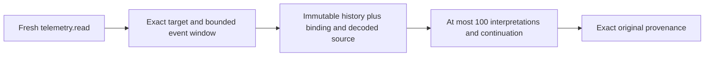

# Property history and provenance

## TL;DR

Use fresh tenant `telemetry.read` authority. Query one exact asset/property
version with a half-open event-time window of at most seven days and a page
size of at most 100. Follow returned opaque keys. Values and attribution remain
immutable; history pages are not a live snapshot or an archive-completeness
claim. [ADR 0119](../adr/0119-expose-bounded-property-history.md) owns the contract.

## Deployment and access

1. Apply the complete migration chain including `0036_property_history_queries.sql`.
   Its two indexes scan existing data and take ordinary transactional DDL locks;
   schedule a reviewed maintenance window for deployed large tables. It does
   not backfill values or change prior migrations.
2. Deploy all readers/client types supporting OpenAPI baseline.16 and the new
   closed `telemetry.read` action before issuing that action to any actor.
3. Use existing tenant access administration to grant exact `telemetry.read`.
   Neither `metadata.read`, `metadata.manage`, `access.manage` nor
   `protocol.manage` implies this permission. Tenant suspension, actor suspension,
   identity mapping and grant revocation are checked for every HTTP request.
4. Keep the database private. The runtime reader needs schema usage and SELECT
   on `history.asset_property_changes`, `metadata.signal_binding_revisions`,
   `ingestion.decoded_observations` and `ingestion.accepted_messages`, plus its
   existing current identity/access reads. Configure privileges through reviewed
   deployment policy; this migration issues no broad grants or RLS bypass.

## Query and inspect

The authenticated browser or configured workload client calls:

```http
GET /api/v1/tenants/tenant-a/assets/asset-a/properties/electrical.voltage/versions/1/history?start_at_ms=0&end_at_ms=3000&limit=50
```

`start_at_ms` is inclusive and `end_at_ms` exclusive. Both are canonical signed
64-bit Unix-millisecond decimal strings. The maximum span is 604800000 ms; the
server rejects overflow, reversed/empty windows, unknown parameters and page
sizes outside 1–100. Negative times are valid. The sample is synthetic, not a
recommended production date window.

The `changes` array contains complete interpretations. `next_after` is null at
the end; otherwise repeat exactly the same tenant, asset, property version and
window with `after=<returned token>`. The page size may change. Do not decode,
edit, persist as authority, or reuse the token in another query scope. Keys are
versioned opaque public identifiers, capped at 8192 ASCII bytes, not credentials.

Use an entry's `interpretation` token for its original provenance:

```http
GET /api/v1/tenants/tenant-a/assets/asset-a/properties/electrical.voltage/versions/1/interpretations/{interpretation}
```

The original source message/package/output, device/endpoint/signal, quality,
source unit, device/receipt times, exact binding revision, target property
version and first-resolution cutoffs are returned. Corrections never select a
replacement binding for this read. Raw wire bytes are omitted. Returned text
is untrusted device data; render it as text, never as executable markup.

Integer and decimal telemetry use tagged string values. Binding revisions and
all times are strings too. Clients must retain these exact strings or use an
appropriate arbitrary-precision type; never coerce them through JavaScript
`Number`. Boolean/text values use their native JSON kinds. Property versions
and decoded output indexes are u32 numbers.

## Ordering and completeness

Rows sort by event time then full interpretation identity. Two bindings or two
time policies for the same source are separate facts, even when their event
instants coincide. Ordering does not select a latest, best-quality or preferred
source, and no unit conversion is performed.

Pages are not a repeatable snapshot or an append watermark. A late interpretation
behind the cursor will not appear in continuation; restart the window to find
it. A new row ahead of the cursor can appear on a later page. Empty pages do not
prove that an asset/property exists, ingestion is healthy, or archival history
is absent. Unresolved semantic work has no resolved history entry.



## Failure and recovery

All responses use `Cache-Control: no-store`. Authentication failures are 401;
missing authority is 403. Bad bounds/tokens/scope are 400; absent exact
interpretations or another target are 404. Empty history is a successful page.
Database failure/timeouts return a safe 500, never a fake empty success or SQL
diagnostics. Each page statement has a transaction-local five-second timeout;
page limits do not bound every index candidate scanned. Investigate repeated
failures using operator database diagnostics and query plans. Narrow the time
window; do not blindly retry or relax server limits.

After restoring infrastructure, the same read/key can be retried. No history
mutation or reinterpretation is required. Before reverting to a binary that
cannot parse telemetry.read, revoke those grants through audited access
commands and account for immutable audit rows carrying the new vocabulary;
a compatible forward binary is the supported recovery path. Keep migrations,
indexes and original history. D06, full-profile qualification, live state,
archival coverage and hardware qualification remain separate.
