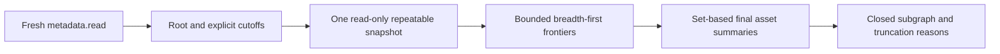

# Bounded semantic graph exploration

## TL;DR

Use current tenant `metadata.read` to query one rooted graph with explicit
effective/known times and bounded depth/assets/links. Inspect `truncated` and
`truncation`; omitted data is never a complete inventory. Graph reads contain
configuration and exact attribution references, not telemetry values or health.
[ADR 0120](../adr/0120-explore-bounded-semantic-graphs.md) owns these semantics.

## Request

Use the listener's existing browser session or configured workload credential:

```http
GET /api/v1/tenants/tenant-a/assets/asset-a/semantic-graph?effective_at_ms=50&known_at_ms=50&depth=2&asset_limit=50&relationship_limit=100&binding_limit=100
```

Times are signed Unix milliseconds, using the existing metadata snapshot wire
contract. Supply both times; omission and unknown parameters are rejected.
Depth is 0–4, assets 1–100 and each link kind 1–200. Defaults are 2/50/100/100.
The sample times are synthetic. Existing metadata-read permission is sufficient;
no telemetry or management permission is implied or required.

Root depth is zero. Expansion follows relationships and source-device/target
bindings in both directions, while the response preserves directed source and
target meaning. Relationships are considered before bindings at each layer;
identity order breaks ties. This deterministic prefix is not a priority ranking.

## Response and interpretation

The response includes the root, exact applied cutoffs and budgets, ID-ordered
asset summaries, typed directed relationship revisions, and signal-binding
revisions with source endpoints and pinned property versions. Original revision
numbers remain strings as in existing metadata responses. Both endpoint assets
of every returned link are present. Assets are unique; self-links and legal
cycles are retained. The root's current immutable catalogue existence is not a
historical asset-creation assertion.



`truncated=false` has an empty `truncation` list. A true flag always has one or
more reasons:

| Reason | Meaning |
|:--|:--|
| `depth` | An observed link would introduce an asset beyond the hop limit. |
| `assets` | An observed link could not include all endpoint assets within the node budget. |
| `relationships` | The relationship adjacency prefix had an extra look-ahead row. |
| `bindings` | The binding adjacency prefix had an extra look-ahead row. |

Reasons can coexist. Rejected links can leave counts below a limit even when a
prefix was truncated. The result is not necessarily induced: there can be
omitted links between included vertices. At the depth boundary, internal links
may still be included, but no new asset is introduced. Do not infer a tree,
absence of cycles, sensor inventory, current values or asset condition.

There is no next-page cursor. Choose another root or increase budgets within
ceilings for a different bounded view. Separate requests have independent
snapshots: concurrent backdated metadata commits may change results even with
the same effective/known cutoffs. Do not label a union of responses atomic.

## Temporal and authorization behavior

Relationships and bindings first select their latest revision known at
`known_at_ms`, then apply half-open effective intervals and final endpoints.
A correction moving an endpoint away removes the old edge from this snapshot;
it never resurrects an obsolete revision. Existing physical or semantic links
may be missing because they were not effective, not known, outside budgets,
or never configured. Empty telemetry is unrelated to these metadata reads.

Authentication and current tenant permission precede parameter validation and
resource lookup. Revocation, actor suspension and tenant suspension apply to
each request, including historical cutoffs. Unknown roots return 404; isolated
known roots return a complete single-asset response. All responses are no-store.

## Failure, rollout and verification

Each PostgreSQL statement has a two-second timeout in a read-only repeatable-read
transaction, with an eight-second idle-transaction limit. The complete HTTP graph
operation has an eight-second deadline. Storage/timeout failures return safe 500
problem details, not an apparently complete partial response. The read session
is dropped on completion/cancellation and its local settings are not retained in
the pool. No recovery writes, queues or materialized graph stores are involved.

Existing metadata SELECT privileges and endpoint/target indexes suffice. No SQL
migration, additional grant, dependency or graph database is introduced. LIMIT
bounds result materialization, not every candidate scanned; repeated failures
need operator query-plan review and measured optimization. Do not add blind
retries or silently raise budgets/timeouts. Serve updated OpenAPI baseline.17 to
clients. D06, full-profile infrastructure and installed qualification remain
separate; this endpoint does not activate deployments or devices.

CI exercises real PostgreSQL temporal/fan-out/snapshot/lock-wait cases and the
HTTP contract. Local focused compilation/lint, pure coordinator tests and
structural/contract checks supplement but do not replace that acceptance gate.
