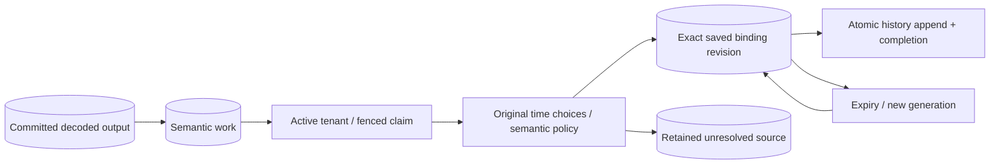

# Durable semantic worker

## TL;DR

Apply migration 0035, then run `fleetiq-server semantic-worker` with the normal
runtime `DATABASE_URL`. The command checks schema and never runs DDL. It emits
no raw observation, identifier, SQL diagnostic or credential. D06 and
full-profile qualification remain deferred.

## Start and stop

1. Apply the reviewed migrations with the migration role using
   `fleetiq-server migrate`.
2. Supply `DATABASE_URL` through the installation's existing private runtime
   configuration. Do not place credentials in process arguments or Git.
3. Start `fleetiq-server semantic-worker`. It opens no HTTP or device port and
   requires no OIDC configuration or protocol executor.
4. Send the ordinary process termination signal to stop. Cancellation rolls
   back an open transaction; a previously committed selection waits for lease
   expiry and remains recoverable by another worker.

For local development, the existing PostgreSQL service uses loopback port
55432. After migrations, start the opt-in worker:

```bash
docker compose -f deploy/local/compose.yaml --profile semantic up --build semantic-worker
```

The HTTP health probe is intentionally disabled for this non-HTTP command; a running process
is not a claim of source freshness or semantic success.

## Database privileges

Migration 0035 does not grant custom deployment roles. Before resuming ingestion,
ensure its existing database role has `USAGE` on `history` and `INSERT` on
`history.semantic_work`: the source handoff executes with invoker privileges,
without `SECURITY DEFINER` elevation. Without these privileges, the entire source
transaction fails closed even if the semantic worker is not running.

The worker's reviewed runtime role needs reads of the existing immutable
source/metadata facts and schema usage, `SELECT`/`INSERT`/`UPDATE` on
`history.semantic_work`, `SELECT`/`UPDATE` on `history.semantic_backfill`,
`INSERT`/`SELECT` on `history.asset_property_changes`, and the existing tenant row-lock
privileges for `SELECT ... FOR SHARE`. It never changes tenant state or metadata.
Retain read access to the migration ledger for checked startup. Configure these
permissions through the installation's reviewed role policy; do not give the
worker DDL authority or apply blanket grants to unrelated roles.

## Processing contract



Each turn discovers at most 32 pre-migration source keys and processes one
claim. New source inserts queue work in their own transaction. Zero-output
decoded messages create no semantic work. Discovery is keyset/checkpoint based;
a newly inserted source behind its cursor is still covered by the trigger.

Policy 1 saves the device-time basis when available, otherwise the receipt-time
basis, and a database knowledge cutoff at enqueue. It does not validate clock
accuracy. It does not change those choices on restart. A compatible binding is
pinned before append; corrections never overwrite original history. A saved
revision that fails immutable lineage checks remains a failure, not permission
to choose another binding.

Claims expire after 30 seconds. A maximum of three generations bounds abandoned
or failing attempts; a final expired claim becomes `exhausted`. Completion
requires an active tenant and the exact unexpired fence. Tenant share locks
order interpretation writes against lifecycle suspension. Unresolved work is
terminal for ordinary polling even after an operator adds configuration.

The worker uses four database connections, one in-flight claim, five-second
statements, a ten-second turn deadline, and a 250 ms pause after idle/failure.
Multiple instances can claim different work with SKIP LOCKED. These bounds are
functional recovery policy, not measured fleet capacity or a throughput SLA.

## Inspect retained outcomes

Use an authorized database session. The following aggregate contains no raw
values, wire payload, external identifier or credential:

```sql
SELECT status, reason, count(*)
FROM history.semantic_work
GROUP BY status, reason
ORDER BY status, reason;

SELECT completed FROM history.semantic_backfill;
```

For an exact authorized source, inspect its work row's policy version, selected
basis, knowledge cutoff, generation, lease deadline, binding revision and closed
reason. Correlate its tenant/message/decoder/output reference with existing
immutable source/history reads. Do not infer connectivity, device health or
worker liveness from lease status. Do not export source identifiers into routine
logs or public reports.

## Recovery and limitations

- A process crash or ambiguous selection commit: wait for database lease expiry;
  a new generation reloads the saved exact binding if one committed.
- Ambiguous completion commit: progress and history are atomic. A completed row
  is not reclaimed; an uncommitted transaction retries the same saved selection.
- Suspended tenant: work is retained; reactivation makes eligible pending work
  claimable again. Exhausted/unresolved rows remain terminal.
- Missing binding, ambiguity, missing definition, value-kind mismatch or unit
  conversion: inspect the closed reason and original source/time choices. There
  is no automatic metadata refresh, reset, deletion or reinterpretation command.
- Do not hand-edit the original time choices, binding selection or terminal
  status to force a pass. A later correction/reprocessing slice must preserve
  original evidence and define new interpretation identity explicitly.

[ADR 0118](../adr/0118-run-durable-semantic-processing.md) records the ownership,
transaction, retry and timestamp decisions. Public hot-history queries, live
state, analytics, hardware qualification and production deployment are separate
work.

## Current-state enqueue handoff

Migration 0037 adds an AFTER INSERT history trigger that queues current-state
projection work in the same commit. Install the additional reviewed invoker
privileges before resuming semantic writers, even when the projector is off.
Missing grants fail the whole history append; they do not silently drop work.
See the [current-state projector procedure](current-property-state.md).
